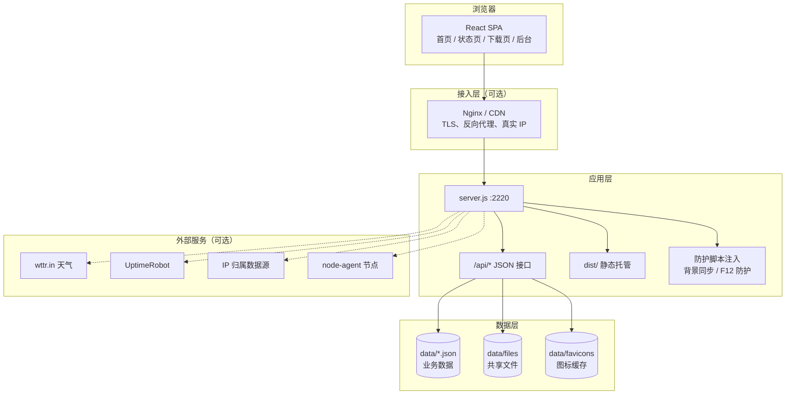

# 幻终の导航 · Huanzhong Nav

> 一个可自托管的网址导航与文件共享系统：React 前端、零依赖 Node.js 后端、本地 JSON 数据库，开箱即用。

<p align="center">
  
  
  
  
  
  
</p>

<p align="center">
  <a href="#-项目简介">项目简介</a> ·
  <a href="#-功能特性">功能特性</a> ·
  <a href="#-技术栈说明">技术栈</a> ·
  <a href="#-快速开始">快速开始</a> ·
  <a href="#️-配置项">配置项</a> ·
  <a href="#-部署建议">部署</a> ·
  <a href="#-常见问题">常见问题</a>
</p>

---

## 📖 目录

- [项目简介](#-项目简介)
- [功能特性](#-功能特性)
- [技术栈说明](#-技术栈说明)
- [系统架构](#️-系统架构)
- [快速开始](#-快速开始)
- [配置项](#️-配置项)
- [目录结构](#-目录结构)
- [数据与备份](#-数据与备份)
- [部署建议](#-部署建议)
- [从 v1 升级](#-从-v1-升级)
- [常见问题](#-常见问题)
- [开发与测试](#-开发与测试)
- [贡献指南](#-贡献指南)
- [许可证](#-许可证)

---

## 🎯 项目简介

**幻终の导航**是一套面向个人、团队与小型社区的自托管导航系统。它把“常用网址入口”“公告与运营内容”“文件共享与临时取件”“运行状态监控”“访问安全防护”整合在一个进程内，部署时只需要 Node.js 与一个可写目录。

与常见导航项目相比，本项目有两个明确取舍：

1. **前端现代化，后端极简化。** 前端使用 React + Modern.js 构建为单页应用，交互与主题能力完整；后端坚持零第三方运行时依赖，仅使用 Node.js 内置模块，避免 `node_modules` 体积与供应链风险进入服务端。
2. **数据本地化。** 全部业务数据以 JSON 文件存放在 `data/` 目录，备份与迁移等价于复制一个文件夹，不依赖数据库服务。

**适用场景**

- 个人浏览器主页、团队内部导航站
- 需要公告、友链、QQ 群、留言与反馈的轻量门户
- 带文件共享、取件码下载与运行状态页的小型资源站
- 希望在单机或低配服务器上完成部署，且不想维护数据库的团队

---

## ✨ 功能特性

### 导航前台

| 能力 | 说明 |
| --- | --- |
| 卡片式导航 | 分类筛选、关键词实时过滤、图标自动抓取；支持大卡片 / 紧凑 / 列表三种布局 |
| 搜索与直达 | `/` 聚焦搜索框，输入时联想站点与历史；回车直达唯一匹配站点，或使用当前引擎搜索 |
| 搜索引擎 | 内置必应、谷歌、知乎、B 站、GitHub 五个入口，选择结果保存在本机 |
| 收藏与最近使用 | 卡片星标收藏、收藏置顶；自动记录最近点击，均保存在浏览器本地 |
| 个人偏好 | 字号、圆角、悬浮动效、卡片排序可调，支持导出 / 导入 JSON 跨设备迁移 |
| 拖拽排序 | 前台按住卡片拖动即可按个人习惯排序，可随时恢复默认 |
| 公告与倒计时 | 公告条、公告弹窗、置顶与定时上下线；节日 / 纪念日倒计时 |
| 运营内容 | 每日一言、热门 Top 站点横条、友情链接、QQ 群入口 |
| 互动 | 留言板与意见反馈，未登录访客需通过人机验证；管理员可回复 |
| 主题与视觉 | 明暗主题、后台自定义主题色与整页背景图、站点 Logo、页脚文案 |
| 天气与时钟 | 实时时钟、按时段问候；天气优先浏览器定位，后台城市兜底，服务端缓存 |

### 文件共享

| 能力 | 说明 |
| --- | --- |
| 分块上传 | 1MB 分块、断点续传、同名同大小任务自动复用已上传分块 |
| 文件夹管理 | 多级目录、新建 / 重命名 / 移动 / 批量删除 / 复制粘贴 |
| 在线预览 | 图片、视频、音频、PDF、文本；Markdown 渲染与代码块样式 |
| 下载保护 | 一次性令牌、人机验证、单文件限速、全局与单 IP 并发限制 |
| 打包下载 | 文件夹递归打包为 ZIP 流式输出 |
| 取件码 | 为文件生成 6 位临时取件码，1 小时至 30 天有效，可撤销 |
| 文件替换 | 新内容替换原文件，保留下载数与取件码 |
| 外链引用 | 引用外部文件地址，由服务端令牌代理下载，不落盘 |
| 节点分发 | 可选 `node-agent` 节点，按剩余带宽调度下载，支持节点互联 |

### 管理后台

| 模块 | 说明 |
| --- | --- |
| 仪表盘 | 引导页、访问量、文件、账号、独立访客、登录失败等总览；14 天趋势、24 小时热力图、来源与排行 |
| 引导页 | 增删改查、图标抓取 / 上传、批量导入 JSON / CSV、拖拽排序、死链检测 |
| 内容运营 | 公告、QQ 群、友链、倒计时、留言、反馈、自定义语录 |
| 文件管理 | 上传、目录、编辑文本、替换、取件码、文件策略、批量操作 |
| 网站监控 | 本地探测 + UptimeRobot 接入，失败自动重试、拖拽排序、状态页公开 |
| 账号与安全 | 四级角色、账号创建 / 重置密码 / 删除、IP 封禁、会话强制下线、IP 诊断 |
| 日志审计 | 登录日志与操作日志分类筛选、关键词与日期筛选、CSV / JSON 导出 |
| 系统设置 | 站点信息、功能开关、数值参数、访问控制、拦截页、备份恢复 |

### 安全机制

- **RSA-OAEP 密码传输**：登录、注册、改密、重置密码均在浏览器端加密，服务端不接收明文密码。
- **scrypt 密码存储**：随机盐 + `scrypt` 64 字节摘要，恒定时间比较。
- **一次性 nonce**：加密载荷绑定一次性令牌，防重放。
- **抗 OCR 验证码**：逐字符旋转、倾斜、缩放，叠加正弦扭曲、干扰曲线与噪点，服务端一次性校验。
- **分级限流与封禁**：全局 API、登录、验证码、下载发起、取件码解析分别限流；连续失败自动封禁 IP。
- **SSRF 防护**：抓取图标、检测链接、代理天气与节点请求时校验目标地址，拒绝内网、回环与云元数据地址。
- **输出与上传防护**：SVG 消毒、CSP、`nosniff`、`X-Frame-Options`、ZIP 炸弹校验、原型污染防护。
- **角色隔离**：访客无任何前台权限；管理员不能接管站长账号；系统始终保留至少一个站长。

---

## 🧱 技术栈说明

| 层级 | 技术 | 版本 | 用途 |
| --- | --- | --- | --- |
| 前端框架 | React | 19 | 组件化 UI 与状态管理 |
| 应用框架 | Modern.js | 3.11 | 文件路由、构建、开发服务器与代理 |
| 组件库 | Mantine | 8.3 | 表单、弹窗、表格、主题与可访问性 |
| 图标 | Tabler Icons | 3.50 | 全站统一线性图标 |
| 语言 | TypeScript | 5.7 | 前端类型约束 |
| 样式 | 原生 CSS + CSS Variables | — | 主题色、背景图、卡片与响应式布局 |
| 后端 | Node.js 内置模块 | ≥ 18 | HTTP 服务、API、静态托管、加密、ZIP |
| 数据库 | 本地 JSON 文件 | — | 零依赖持久化，目录级备份 |
| 可选节点 | `node-agent.js` | — | 独立文件节点、心跳与带宽上报 |

**组件职责**

- `server.js`：单一 HTTP 入口，负责 API 路由、会话与权限、访问控制、文件分块、ZIP 备份恢复、静态资源托管与全站防护脚本注入。
- `zip.js`：零依赖 ZIP 写入与解析，支持流式打包、条目校验与解压上限。
- `node-agent.js`：可选的独立节点服务，向主站心跳并接收文件分片。
- `src/`：React 单页应用，包含前台、状态页、下载页与后台四个路由入口。

---

## 🏗️ 系统架构



**请求链路**

1. 浏览器请求 `/`、`/admin`、`/status`、`/download` 时，`server.js` 返回同一份构建入口 `dist/html/index/index.html`，由 React 路由渲染对应页面。
2. 页面初始化调用 `/api/auth/info` 获取站点配置、功能开关与限制，再按需加载站点、公告、文件等数据。
3. 写操作统一走 `/api/*`，服务端完成会话校验、角色判断、限流、人机验证与审计日志。
4. 共享文件下载先申请一次性令牌，再由 `/files/dl/<token>` 流式输出；令牌过期或重复使用即失效。
5. 反向代理部署时，只有在代理已清洗 `X-Forwarded-For` 的前提下才可开启 `TRUST_PROXY=true`，否则真实 IP 可被伪造。

---

## 🚀 快速开始

### 环境要求

| 项目 | 要求 |
| --- | --- |
| Node.js | ≥ 18（构建与运行均建议 20 / 22 LTS） |
| npm | ≥ 9 |
| 操作系统 | Windows / Linux / macOS |
| 可选 | Nginx、pm2 / systemd、MCSM 面板 |

> 后端运行时只依赖 Node.js 内置模块；`npm install` 仅用于安装前端构建工具链。

### 第一步：获取源码

```bash
git clone https://github.com/RTHLanStar/Huanzhong-Nav-Agent.git
cd Huanzhong-Nav-Agent
```

### 第二步：安装依赖并构建前端

```bash
npm install
npm run build
```

构建完成后生成：

```text
dist/
├── html/index/index.html    # SPA 入口
└── static/                  # 带哈希的 JS / CSS 资源
```

### 第三步：启动服务

```bash
npm start
# 等价于 node server.js
```

默认监听 `0.0.0.0:2220`。可通过环境变量修改端口：

```bash
PORT=8080 npm start
```

启动成功输出：

```text
==============================================
  幻终の导航 已启动
  前台首页: http://localhost:2220/
  管理后台: http://localhost:2220/admin
  数据目录: /path/to/project/data
==============================================
```

### 第四步：初始化站长

1. 打开 `http://服务器IP:2220/admin`。
2. 系统检测到无账号时，自动进入「注册站长」模式，创建首个账号。
3. 首位注册者获得 **站长** 角色，可管理角色、系统设置与全部内容。
4. 在「系统设置」中修改站点名称、Logo、主题色、背景与功能开关。

> 后续自助注册的账号默认为 **访客**，无前台与后台权限，需站长在「账号管理」中提升角色。

### 第五步：验证部署

```bash
curl http://127.0.0.1:2220/api/auth/info
```

应返回包含 `siteName`、`firstRun`、`features` 的 JSON。也可以直接访问：

| 页面 | 地址 |
| --- | --- |
| 导航首页 | `http://服务器IP:2220/` |
| 管理后台 | `http://服务器IP:2220/admin` |
| 运行状态 | `http://服务器IP:2220/status` |
| 文件下载 | `http://服务器IP:2220/download` |

### 开发模式

开发时前后端分离启动，Modern.js 开发服务器会把接口与运行时静态目录代理到 2220：

```bash
# 终端 1：启动 Node 后端
npm start

# 终端 2：启动前端开发服务器（默认 8080，支持 HMR）
npm run dev
```

访问 `http://localhost:8080/` 即可。代理规则位于 `modern.config.ts` 的 `dev.server.proxy`。

---

## ⚙️ 配置项

### 环境变量

| 变量 | 默认值 | 说明 |
| --- | --- | --- |
| `PORT` | `2220` | 服务监听端口 |
| `TRUST_PROXY` | `false` | 是否信任反向代理传入的真实 IP。直连部署必须保持 `false` |
| `HUANZHONG_DATA_DIR` | `./data` | 数据目录；测试或隔离部署可指定独立目录 |
| `UPTIMEROBOT_API_KEY` | 空 | UptimeRobot Read-Only API Key，优先级高于后台配置 |
| `UPTIMEROBOT_API_URL` | `https://api.uptimerobot.com/v2/` | UptimeRobot API 地址，可替换为自建代理 |

### 后台可调参数

登录后台 →「系统设置」，保存后即时生效，无需重启：

| 配置项 | 默认值 | 说明 |
| --- | --- | --- |
| 站点名称 | 幻终の导航 | 1–30 字 |
| 注册开关 | 开启 | 开启后自助注册默认访客角色 |
| 登录人机验证 | 开启 | 登录与注册需图形验证码 |
| 主题色 | `#007aff` | 首页、下载页、后台的强调色 |
| 整页背景图 | 空 | 支持上传或外链，自动叠加可读性遮罩 |
| 页脚文案 | 空 | 备案号、版权或一句话介绍 |
| 天气显示 | 关闭 | 开启后按访客定位查询，城市名可作兜底 |
| 每日一言 | 关闭 | 使用内置语录池或自定义语录 |
| 定时死链检测 | 关闭 | 1–168 小时检测一次全部引导页 |
| 访问控制 | 全部关闭 | 国内 / 海外 / 机房 IP 拦截，机房可自动关闭页面 |
| F12 防护 | 关闭 | 非登录访客禁用调试快捷键与右键菜单 |
| 功能开关 | 全部开启 | 公告、QQ 群、留言、反馈、倒计时、友链、热门、访客统计、手气不错、最近使用、文件共享、取件码 |
| 留言 / 反馈字数 | 200 / 300 | 1–2000 字 |
| 热门横条条数 | 6 | 1–20 条 |
| 取件码默认有效期 | 24 小时 | 1–720 小时 |
| 下载限速 | 0.5 MB/s | 0–100 MB/s，0 为不限速 |
| 单文件上限 | 200 MB | 1–2048 MB |
| 登录封禁阈值 | 3 次 | 1–10 次 |
| IP 封禁时长 | 10 分钟 | 1–1440 分钟 |
| 热力图天数 | 7 天 | 1–30 天 |

### 代码内常量

以下常量位于 `server.js` 顶部，作为默认值与硬上限：

| 常量 | 默认值 | 说明 |
| --- | --- | --- |
| `SESSION_TTL` | 7 天 | 登录会话有效期 |
| `MAX_ATTEMPTS` | 3 | 登录失败封禁阈值（后台可调） |
| `BAN_DURATION` | 10 分钟 | IP 封禁时长（后台可调） |
| `RATE_API_MAX` | 240 / 分钟 | 全局 API 每 IP 限流 |
| `DOWNLOAD_RATE` | 0.5 MB/s | 共享文件下载限速（后台可调） |
| `FILE_MAX` | 200 MB | 单文件上传上限（后台可调） |
| `SHARE_DEFAULT_TTL` | 24 小时 | 取件码默认有效期（后台可调） |
| `SHARE_MAX_TTL` | 30 天 | 取件码最长有效期 |
| `ZIP_TOTAL_MAX` | 2 GB | 单次打包 ZIP 总大小上限 |
| `BACKUP_MAX` | 1 GB | 完整备份文件上限 |
| `IMPORT_MAX_ROWS` | 500 | 单次批量导入引导页上限 |
| `STATUS_MONITOR_CHECK_INTERVAL` | 5 分钟 | 本地监控探测间隔 |
| `STATUS_HISTORY_DAYS_MAX` | 90 天 | 监控历史最长保留 |
| `WEATHER_CACHE_TTL` | 10 分钟 | 天气服务端缓存 |
| `GEO_CACHE_TTL` | 24 小时 | IP 归属查询缓存 |

---

## 📁 目录结构

```text
Huanzhong-Nav-Agent/
├── src/                          # React 前端源码
│   ├── components/
│   │   └── AppProviders.tsx      # 站点配置、主题、全局通知
│   ├── features/
│   │   ├── home/                 # 导航首页与弹窗
│   │   ├── status/               # 运行状态页
│   │   ├── download/             # 文件下载页
│   │   └── admin/                # 管理后台各模块
│   ├── lib/                      # API、RSA、格式化、Markdown、主题
│   ├── routes/                   # Modern.js 文件路由
│   │   ├── layout.tsx
│   │   ├── page.tsx              # /
│   │   ├── admin/page.tsx        # /admin
│   │   ├── status/page.tsx       # /status
│   │   └── download/page.tsx     # /download
│   └── styles/global.css         # 设计变量与页面样式
├── server.js                     # Node.js 后端：API、会话、静态托管
├── zip.js                        # 零依赖 ZIP 打包 / 解包
├── node-agent.js                 # 可选节点代理
├── node-agent.config.example.json
├── review-regression.js          # 端到端回归测试
├── modern.config.ts              # Modern.js 构建与开发代理配置
├── tsconfig.json
├── package.json
├── public/                       # 默认站点图标
├── test/rsa.js                   # 回归测试用的浏览器端 RSA 实现
├── data/                         # 运行时数据（自动创建，不入库）
├── dist/                         # 前端构建产物（自动创建，不入库）
├── 批量导入示例.json / .csv / .xlsx
├── 部署教程.md                    # MCSM 面板部署图文教程
├── LICENSE
└── README.md
```

运行时数据目录：

```text
data/
├── users.json            # 账号
├── sites.json            # 引导页
├── visits.json           # 访问统计、独立访客、来源、小时分布
├── logs.json             # 登录与操作日志
├── settings.json         # 系统设置
├── monitors.json         # 本地网站监控
├── status-config.json    # UptimeRobot 配置（0600，不随备份导出）
├── sessions.json         # 登录会话（仅存哈希键）
├── bans.json             # IP 封禁
├── nonces.json           # 一次性加密令牌
├── favicons.json         # 图标缓存索引
├── files.json            # 共享文件元数据
├── folders.json          # 文件目录树
├── announcements.json
├── qqgroups.json
├── sharecodes.json
├── comments.json
├── countdowns.json
├── friendlinks.json
├── feedbacks.json
├── quotes.json
├── uploads/              # 上传的 Logo / 背景 / 图标
├── favicons/             # 抓取的网站图标
├── files/                # 共享文件本体
└── backup-tmp/           # 完整备份恢复的临时分片
```

---

## 💾 数据与备份

**方式一：后台备份（推荐）**

- 「系统设置」→「导出数据备份」：JSON 元数据，不含文件本体。
- 「系统设置」→「导出完整备份」：ZIP，包含 `backup.json` 与全部共享文件。
- 恢复时上传对应文件；完整恢复按 1MB 分块上传并校验总大小与 ZIP 条目上限。

**方式二：目录备份**

停服后复制整个 `data/` 目录即可。恢复时替换目录并重启。

> `status-config.json` 含 UptimeRobot API Key，不包含在备份中；迁移后需重新填写或使用环境变量。

---

## 🌐 部署建议

### Nginx 反向代理

```nginx
server {
    listen 80;
    server_name nav.example.com;

    client_max_body_size 210m;

    location / {
        proxy_pass http://127.0.0.1:2220;
        proxy_http_version 1.1;
        proxy_set_header Host $host;
        proxy_set_header X-Real-IP $remote_addr;
        proxy_set_header X-Forwarded-For $proxy_add_x_forwarded_for;
        proxy_set_header X-Forwarded-Proto $scheme;
        proxy_read_timeout 300s;
    }
}
```

启用代理后，以环境变量启动：

```bash
TRUST_PROXY=true PORT=2220 npm start
```

> **安全前提**：只有 Nginx/CDN 已覆盖客户端伪造的 `X-Forwarded-For` 时才可开启 `TRUST_PROXY`。直连部署保持 `false`，否则攻击者可伪造 IP 绕过封禁与访问控制。

### systemd

```ini
[Unit]
Description=Huanzhong Nav
After=network.target

[Service]
Type=simple
WorkingDirectory=/opt/huanzhong-nav
ExecStart=/usr/bin/node server.js
Environment=PORT=2220
Restart=always
RestartSec=3
User=www-data

[Install]
WantedBy=multi-user.target
```

```bash
sudo systemctl daemon-reload
sudo systemctl enable --now huanzhong-nav
```

### pm2

```bash
pm2 start server.js --name huanzhong-nav
pm2 save && pm2 startup
```

### MCSM 面板

参考 [部署教程.md](./部署教程.md)。注意：部署前需在本地或服务器执行 `npm install && npm run build`，或将构建后的 `dist/` 一并上传。

---

## 🔄 从 v1 升级

1. **数据兼容**：`data/` 目录结构与 JSON 字段保持兼容，直接沿用旧数据即可。
2. **前端构建**：v1 的 `public/*.html` 已由 React SPA 取代；升级后必须执行 `npm install && npm run build`。
3. **启动方式**：仍为 `node server.js`；`server.js` 现在托管 `dist/`，不再读取旧 HTML。
4. **登录会话**：旧会话使用哈希键存储，升级后可继续使用；如遇异常，清除浏览器 `ht_token` Cookie 后重新登录。
5. **个性化数据**：收藏、最近使用、布局偏好仍使用原 `localStorage` 键（`ht_favs`、`ht_recent`、`ht_prefs` 等），升级不丢失。

---

## ❓ 常见问题

**Q：启动后页面 404，或提示未找到构建产物？**

> 先执行 `npm install && npm run build`。`server.js` 托管的是 `dist/html/index/index.html`，不再读取 `public/*.html`。

**Q：`npm install` 很慢或失败？**

> 前端依赖仅用于构建。可切换镜像后重试：`npm config set registry https://registry.npmmirror.com`。构建完成后，运行时不需要 `node_modules`。

**Q：忘记管理员密码怎么办？**

> 停服后编辑 `data/users.json`，删除忘记密码的账号，重启后访问 `/admin` 重新注册首位站长；若还有其他站长账号，可直接登录后台重置。

**Q：如何修改端口？**

> 使用 `PORT=8080 npm start`，或修改 `server.js` 顶部的默认端口。

**Q：放在 Nginx / CDN 后面，如何获取真实 IP？**

> 确认代理已清洗并覆盖 `X-Forwarded-For` / `X-Real-IP`，再设置 `TRUST_PROXY=true`。否则保持默认 `false`。后台「安全防护 → IP 诊断」可核对服务端实际识别的地址与判定结果。

**Q：验证码看不清怎么办？**

> 点击验证码图片可刷新。验证码为一次性，提交后无论对错都会失效；连续失败会触发限流或 IP 封禁。

**Q：图标不显示？**

> 后台「引导页管理」点击该行的图标按钮重新抓取，或手动上传图标。目标站点不可访问、返回防盗链时可能抓取失败。

**Q：如何批量添加引导页？**

> 「引导页管理」→「批量导入」，支持 JSON / CSV。字段：`name`、`url` 必填，`desc`、`category`、`icon` 选填；单次最多 500 条，失败行会返回原因。

**Q：上传大文件中断了怎么办？**

> 重新上传同名、同大小文件即可续传，服务端会跳过已接收分块。上传任务保留 24 小时。

**Q：如何临时分享文件？**

> 文件菜单 →「取件码」，选择有效期后生成 6 位码。对方在 `/download` 输入取件码，或直接访问 `https://站点/download?code=XXXXXX`。

**Q：状态页没有数据？**

> 未配置 UptimeRobot 时，状态页回退到本地监控；需先在「网站监控」添加监控项，服务端每 5 分钟探测一次并保留 90 天历史。

**Q：天气不显示？**

> 天气依赖服务器访问 `wttr.in`，且浏览器定位仅在 HTTPS 或 localhost 下可用。定位失败时会回退到后台填写的备用城市。

**Q：访客统计如何去重？**

> 浏览器首次访问生成匿名令牌（`localStorage`），同日同令牌只计 1 位独立访客；不采集 IP 与身份信息，来源仅记录域名。

**Q：前台布局、收藏、排序存在哪里？**

> 全部保存在访客浏览器 `localStorage`，不占用服务器存储。可通过「偏好设置 → 导出个人偏好」跨设备迁移。

---

## 🧪 开发与测试

```bash
npm run dev      # 前端开发服务器 8080，/api 代理到 2220
npm run build    # 生产构建
npm test         # 先构建，再运行端到端回归测试
```

回归测试覆盖：首启注册与会话、角色权限、验证码与加密登录、引导页与批量导入、文件分块 / 续传 / 预览 / 取件码、节点心跳与调度、日志、备份恢复、访问控制与静态资源托管等。

**代码约定**

- 前端组件使用函数组件与 Hooks，类型定义集中在 `src/lib/types.ts`。
- 所有接口调用经由 `src/lib/api.ts`，统一错误信息与凭证携带。
- 后端新增接口需在 `server.js` 的 `route()` 注册，并补充 `auth` 标记与审计日志。
- 修改 `server.js` 后执行 `node -c server.js` 做语法校验。

---

## 🤝 贡献指南

欢迎提交问题、建议与代码：

1. Fork 本仓库并创建分支：`git checkout -b feature/your-feature`。
2. 保持改动聚焦，前端改动请附截图或交互说明。
3. 提交前运行 `npm test` 与 `npm run build`。
4. 提交 Pull Request，描述变更动机、实现方式与验证结果。

**报告问题**请附：版本 / 提交号、部署方式（直连或反代）、Node.js 版本、复现步骤、浏览器控制台与服务端日志。

---

## 📄 许可证

本项目采用 **Business Source License 1.1（BUSL-1.1）**，完整条款见 [LICENSE](./LICENSE)。

| 参数 | 内容 |
| --- | --- |
| Licensor | RTHLanStar |
| Licensed Work | Huanzhong Nav（幻终の导航）2.0.0 |
| Change Date | 2030-11-05 |
| Change License | MIT License |
| Additional Use Grant | 允许个人、教育与非营利场景的非商业生产使用；商业生产或付费托管需获得商业授权 |

**使用范围**

- **允许**：学习、测试、修改、分发，以及个人主页、团队内部、教育与非营利项目的非商业生产部署。
- **需要商业授权**：将本项目用于商业生产环境，或以付费服务、SaaS、托管平台等形式对外提供。
- **自动转开源**：Change Date 到期后，该版本将按 MIT License 授权。
- BUSL-1.1 不是 OSI 认可的开源许可证；在 Change Date 之前，请在上述范围内使用。

商业授权与参数调整请联系仓库维护者。

---

<p align="center">
  <sub>把常用入口收拢到一页，把复杂留给后端。</sub>
</p>
